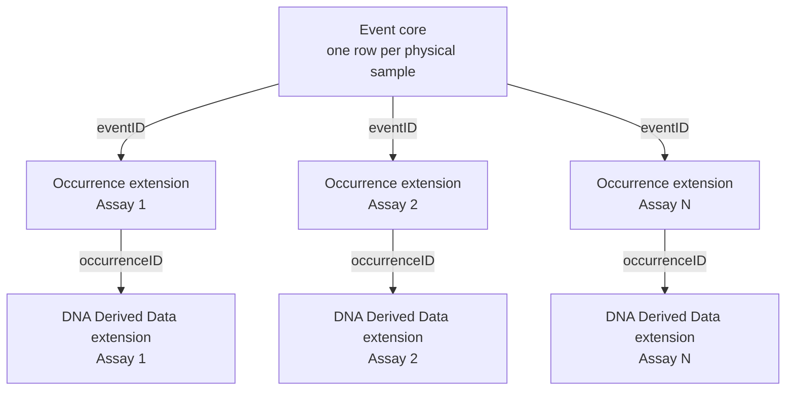

# Multi-Assay Toolkit (MAT)

**An open-source tool that turns FAIRe-formatted eDNA metabarcoding data into a Darwin Core Archive, with any number of assays published together as one dataset.**

The Multi-Assay Toolkit (MAT) reads [FAIRe](https://fair-edna.github.io/) spreadsheets and writes a standards-compliant [Darwin Core Archive](https://dwc.tdwg.org/text/) (DwC-A), ready to publish through an [IPT](https://www.gbif.org/ipt) to [OBIS](https://obis.org/) or [GBIF](https://www.gbif.org/). It comes as a guided web app (R Shiny) and as plain R scripts. It is free to use, host and adapt under the MIT licence.

## Why this exists

eDNA metabarcoding projects often collect one set of physical samples (water, sediment, soil) and run them through **several primer sets ("assays")** to detect different groups of organisms. The sampling information (dates, coordinates, depth, environmental readings) is identical for every assay, because it is the same physical sample. Only the sequencing and taxonomy results differ.

GBIF's [Metabarcoding Data Toolkit (MDT)](https://mdt.gbif.org/) is the most widely used tool for publishing metabarcoding data, and it works well for a single assay. It is built around an Occurrence core, where **one dataset = one assay**. Its user guide says: *"Mixed datasets (e.g., different primer sets used for the same set of samples) should be published separately."* A project with three assays becomes three unrelated datasets, each repeating the same sample metadata.

MAT builds the archive around an **Event core** instead, following the [OBIS-ENV-DATA](https://manual.obis.org/dna_data.html) pattern:

- **One Event core.** Each physical sample is written once.
- **One Occurrence extension per assay.** The detections (ASVs) from each primer set, linked to the Event core by `eventID`.
- **One DNA Derived Data extension per assay.** The sequence, PCR and bioinformatics details for each detection, linked by `occurrenceID` and `eventID`.



The result is one dataset that says "these samples were taken once, and N assays were run on them". No sample metadata is repeated.

| | MDT | MAT |
|---|---|---|
| Core type | Occurrence | Event |
| Assays per dataset | One | **Any number** (one, two, three or more) |
| Sample metadata | Repeated in every assay's dataset | Written once |
| Input | OTU table + taxonomy + sample files | FAIRe workbooks, one per assay |
| Taxonomy matching | GBIF backbone | WoRMS, with a review step |

## Who this is for

Anyone with FAIRe-formatted eDNA metabarcoding data who wants to publish it to OBIS or GBIF. It works for a single assay, and it is most useful when a project has two or more. The tool was built at the Minderoo OceanOmics Centre at UWA for marine data, so taxonomy is matched against WoRMS.

## What the web app does

The app is a seven-step wizard. Nothing is published automatically: a person reviews each stage.

| Step | What happens |
|---|---|
| 1. Upload | Enter a project ID and upload one FAIRe workbook per assay. Choose the file type (curated reference database or NCBI nt); a dataset must use one type only. |
| 2. Validate | Checks sheets, headers and that every assay describes the same samples. |
| 3. Build | Match each assay to its `projectMetadata` column(s), then build the Event core and the Occurrence and DNA Derived Data extensions. A mapping check compares every output column with the official GBIF term definitions. |
| 4. Taxonomy | Match every scientific name against [WoRMS](https://www.marinespecies.org/). Review names that are ambiguous, unmatched or not recorded as marine. |
| 5. QC Checks | Run OBIS quality checks ([`obistools`](https://github.com/iobis/obistools)) plus ID and coordinate checks. |
| 6. Metadata | Fill in the dataset metadata (`eml.xml`), by form or from an Excel template. |
| 7. Results | View a one-page analysis report, then download the archive, save it as a draft, or publish it to your storage. |

More detail on two steps:

- **Assay mapping (Step 3).** Each uploaded assay has to be matched to its `projectMetadata` column(s) (`assay1`, `assay2`, … any number of columns). The app suggests a match and shows every column as a card (assay name, target gene, target taxa, primers) for you to tick or untick. Suggestions are made in this order:
  1. `projectMetadata`'s own `assay_name` matches the file's assay name, ignoring case and punctuation (`MiFish-U` = `MiFishU`).
  2. A combined assay is built from several columns' names (`MiFishUE2` → `MiFish-U` + `MiFishE2`). This works even when the same project also has separate `MiFishU` and `MiFishE2` files.
  3. Otherwise, the single most similar column by primer or gene name.

  Always check the suggestion before building.

- **Not-marine review (Step 4).** After WoRMS matching, names WoRMS doesn't record as marine are listed with their WoRMS habitat, the number of records, and an **OBIS outcome**. This predicts what OBIS's own quality check ([`obis-qc`](https://github.com/iobis/obis-qc)) will do after publishing:

  | OBIS outcome | When | What happens |
  |---|---|---|
  | Kept | WoRMS: marine or brackish | Published normally |
  | Kept – marked unsure | WoRMS: no marine or brackish record (e.g. freshwater only) | Published, with a `MARINE_UNSURE` flag |
  | Will be dropped | WoRMS: marine = no **and** brackish = no | Hidden from OBIS searches (still in the dataset download) |

  The OBIS outcome is a review aid only and isn't written into the archive. OBIS publishes most of these taxa, and GBIF publishes all of them, so contamination has to be removed before upload:
  - **Check** opens a popup with tabs for WoRMS, OBIS (its habitat flags, verdict and existing record counts), FishBase or SeaLifeBase (picked automatically: fish vs other animals), GBIF (classification, common name, habitat for any organism) and Wikipedia.
  - **Exclude** removes that taxon from the Occurrence and DNA Derived Data files, and adds a sentence listing it to the `eml.xml` methods. Everything is kept unless you exclude it.

  The Check popup calls public APIs (WoRMS, OBIS, GBIF, Wikipedia; no keys needed), so it needs internet access and takes a few seconds to open. If one service is down, only that tab is affected.

## Getting started

### 1. Install

You need R (developed against 4.5.x) and these packages:

```r
install.packages(c(
  "readxl", "dplyr", "tidyr", "readr", "tibble", "worrms", "remotes",        # pipeline
  "shiny", "bslib", "bsicons", "DT", "ggplot2", "zip", "openxlsx", "scales",  # web app
  "maps", "xml2", "base64enc", "aws.s3", "sodium", "emayili"
))
remotes::install_github("iobis/obistools")   # not on CRAN
```

`curl` and `jsonlite` are also used; they are installed with `worrms`.

### 2. Get the code

```bash
git clone https://github.com/Minderoo-OceanOmics-Centre-UWA/faire2obis.git
cd faire2obis
```

### 3. Connect your own storage and email

The app stores saved archives, reports and user accounts in an **AWS S3 bucket that you provide**, and sends login codes from **an email account that you provide**. This repository contains no credentials, and you cannot use ours.

Copy `.Renviron.example` to `.Renviron` (next to `app.R`) and fill it in. `.Renviron` is gitignored, so your credentials are never committed.

**S3: Draft / Publish storage and accounts** (see `R/archive_history.R`)

| Variable | Required | What it's for |
|---|---|---|
| `AWS_ACCESS_KEY_ID` | Yes | Access key for an AWS user that can read and write your bucket |
| `AWS_SECRET_ACCESS_KEY` | Yes | Its secret key |
| `AWS_DEFAULT_REGION` | Yes | The bucket's region, e.g. `ap-southeast-2` |
| `FAIRE2OBIS_S3_BUCKET` | **Yes, for your own install** | Your bucket's name. If unset, the app uses the OceanOmics bucket name, which your credentials cannot access. |
| `FAIRE2OBIS_S3_PREFIX` | No | Parent folder for `Draft/`, `Publish/` and `Report/`. Defaults to `biodiversity-public`. |

To get the keys: in the AWS console create an S3 bucket, create an IAM user with read/write access to that bucket only, and create an access key for that user. If you use the AWS CLI, `aws configure` asks for the same three values; the app reads them from `.Renviron`, not from the CLI's own files.

**Email: sign-up, login codes and password resets** (see `R/user_auth.R`)

| Variable | Required | What it's for |
|---|---|---|
| `SMTP_USER` | Yes | The sending email address |
| `SMTP_PASSWORD` | Yes | An app password for that address, **not** its normal login password (Gmail: Account → Security → 2-Step Verification → App passwords) |
| `SMTP_HOST` | No | Defaults to `smtp.gmail.com` |
| `SMTP_PORT` | No | Defaults to `587` |
| `ALLOWED_EMAIL_DOMAIN` | No | Only addresses on this domain can sign up. Defaults to `uwa.edu.au`, so **set it to your own organisation's domain**. |
| `SUPPORT_CONTACT_EMAIL` | No | Shown in "log in required" messages. Set it to your own contact address. |

Without the S3 variables, the app still runs and Download still works, but saving to Draft or Publish is hidden. Without the SMTP variables, nobody can sign up or log in. Guests can still walk through the whole process without an account.

### 4. Run

```r
shiny::runApp()
```

If you run the app locally with the same `.Renviron` as your live server, both use the same bucket. Drafts saved while testing are real and have to be deleted by hand.

### Accounts and roles

Downloading, saving a draft or publishing needs an account on the allowed email domain, verified by an emailed code.

| Role | Can |
|---|---|
| **User** (default for every new signup) | Download the archive, save it to Draft |
| **Publisher** | Everything a user can, plus move a draft into Publish |
| **Admin** | Everything a publisher can, plus manage accounts and roles |

A saved archive is either a timestamped draft (`Draft/<project>_<date>_<time>.zip`, never overwritten) or that project's published version (`Publish/<project>_CoreVersion.zip`). Both can be reviewed later from the app's Draft and Publish tabs without re-running anything.

## Hosting it for your team

The app is a standard Shiny app, so it runs anywhere Shiny does. The OceanOmics instance runs under [Shiny Server](https://posit.co/products/open-source/shiny-server/) on a [Nectar Research Cloud](https://ardc.edu.au/services/ardc-nectar-research-cloud/) virtual machine, and the same setup works on any Linux server:

1. Install R, Shiny Server and the packages above, so the `shiny` user can load them.
2. Clone this repository into `/srv/shiny-server/faire2obis`.
3. Create `.Renviron` in that folder by hand (step 3 above).
4. Open the server's Shiny port to your users.

To release an update, push to your repository and run `git pull` in the app folder on the server. No restart is needed: new sessions pick up the new code. `git pull` never touches `.Renviron`. If the app shows "Disconnected from server", check the newest log in `/var/log/shiny-server/`.

Include the `reference/` and `templates/` folders when deploying. The `rsconnect/` folder is an old shinyapps.io record and isn't used.

## Input: FAIRe workbooks

One `.xlsx` workbook per assay, each with (at minimum) these sheets: `projectMetadata`, `sampleMetadata`, `experimentRunMetadata`, `taxaFinal`, `otuFinal`.

- `sampleMetadata`, `experimentRunMetadata` and `taxaFinal` have a 3-row header (requirement level, section, column names). The tool handles this for you.
- `otuFinal` is a plain ASV-by-sample read-count matrix with a single header row.
- Every assay's workbook must describe the same samples with the same sample metadata. The tool stops if they disagree.
- `projectMetadata` holds one column per assay (`assay1`, `assay2`, …).

## Output

```
Event.csv                    <- Darwin Core Event core, one row per sample
Occurrence_<assay>.csv       <- one Occurrence extension per assay
DNADerivedData_<assay>.csv   <- one DNA Derived Data extension per assay
eml.xml                      <- dataset metadata
```

Negative and positive control samples are kept out of the archive. They are lab and field QC, not biodiversity records, and are written to a separate reference file.

### PCR value conventions

Two DNA Derived Data terms are numeric in the GBIF definition but often hold more than one number in FAIRe sheets. The tool handles them like this:

| Term | GBIF type | FAIRe value | Written as | Why |
|---|---|---|---|---|
| `ampliconSize` | integer | a range, e.g. `178-228` | `178 \| 228` | Follows [NOAA Omics' metabarcoding-assay guidance](https://github.com/NOAA-Omics/noaa-omics-metabarcoding-assays#assay-preps): *"A range can be entered separated by a bar"*. A combined assay gets its overall range (MiFish-U `163-185` + MiFish-E2 `163-212` → `163 \| 212`). |
| `annealingTemp` | decimal | not one number, e.g. `54-56` for a touchdown PCR | left blank, and `annealingTemp recorded as 54-56 Celsius (not a single value)` added to `pcr_cond` | An average would be wrong for a touchdown PCR. Most OBIS metabarcoding datasets leave this blank and describe the profile in `pcr_cond`. |

`ampliconSize` written as `min | max` is still off-spec for an integer term, so the IPT may flag it. The app's Darwin Core mapping check reports it as expected rather than as an error.

## Publishing through an IPT

The tool produces the archive files. You publish them through any IPT (MDT cannot take a multi-assay dataset):

1. Create a new resource and upload `Event.csv` as the core (Core Type: `Event`, ID field: `eventID`).
2. Add each `Occurrence_<assay>.csv` as a source file, set as an `Occurrence` extension, and map its `eventID` column as the core-linking ID.
3. Add each `DNADerivedData_<assay>.csv` as a source file, set as a `DNA derived data` extension, and map its `eventID` column (not `occurrenceID`) as the core-linking ID. A Darwin Core Archive has no "extension of an extension", so every extension links back to the core's own ID.
4. Map the remaining fields. Most map automatically, because the columns are already named as Darwin Core terms. `seq_id` (the ASV ID) is not a Darwin Core term and stays unmapped; this is expected.
5. Add or check the dataset metadata. The IPT can fill geographic, temporal and taxonomic coverage from the data ("Infer automatically").
6. Publish to a test IPT first.

## Using the R scripts instead of the app

The same pipeline is available as five scripts plus a shared `config.R`, for people who prefer the command line. The scripts need no AWS or email setup.

| Script | What it does |
|---|---|
| `config.R` | Input file paths, project ID, the assay-to-`projectMetadata`-column mapping, output paths and control-sample rules. Edit this first. |
| `01_build_event_core.R` | Reads `sampleMetadata` from every assay's file, checks they agree, separates real samples from controls, and writes the single Event core. |
| `02_build_occurrence.R` | Turns each assay's OTU table into one row per detection, joins the taxonomy, and writes one Occurrence extension per assay. A low-confidence identification falls back to the lowest rank that was actually resolved. |
| `03_build_dna_extension.R` | Writes one DNA Derived Data extension per assay: the sequence, primers, PCR conditions, sequencing platform and bioinformatics details. |
| `04_worms_match.R` | Matches every scientific name against WoRMS to get a `scientificNameID`. Ambiguous or unmatched names go to review files; nothing is guessed. |
| `05_qc_checks.R` | Checks required fields, dates, coordinates, ID links between the core and every extension, and taxonomy coverage. |

```r
source("config.R")
source("scripts/01_build_event_core.R")
source("scripts/02_build_occurrence.R")
source("scripts/03_build_dna_extension.R")
source("scripts/04_worms_match.R")
source("scripts/05_qc_checks.R")
```

`config.R` ships set up for the example project below. For your own data, change:

- `INPUT_FILES`: the path to each assay's FAIRe `.xlsx` file. List as many assays as you have.
- `PROJECT_ID` and `EVENT_CORE_SOURCE_ASSAY`: the assay whose `sampleMetadata` is the source of truth (the others are checked against it).
- `ASSAY_PROJECT_COLUMN`: which `projectMetadata` column(s) belong to each assay. This differs between projects, for example whether MiFish-U and MiFish-E2 were run as one combined assay or as two. The web app suggests this mapping in Step 3.
- `SAMPLE_CATEGORY_KEEP`: the `samp_category` value that marks a real (non-control) sample.
- `ASSOCIATED_SEQUENCES_URI`: where your raw reads are archived, e.g. an ENA or SRA project accession.

Also check which `sampleMetadata` and `taxaFinal` columns are actually filled in for your data before deciding what to map. Some fields with a slot in the FAIRe schema (environmental chemistry, DNA extraction details) may be empty for your project.

## Design principles

- **Never guess.** Ambiguous taxonomy matches, unresolved identifications and missing metadata are shown for review, not silently filled in.
- **Taxonomy matching is a separate, reviewable step**, so a person can check names before they enter a published archive.
- **Control samples never reach the published archive.**
- **Removing a taxon is always a person's decision, and always recorded.** An excluded taxon is listed in the `eml.xml` methods, so data users know what was removed and why.
- **Dates are never zero-padded** for unknown parts (`2011-03`, not `2011-03-00`). A padded date claims a day that was never recorded.
- **`occurrenceID` is unique across the whole archive.** It is built from `eventID` + assay + ASV ID, because ASV numbers repeat between assays.

## Example: a three-assay project

The tool has been run end to end on the OceanOmics project OcOm_2408: surface water samples from the East Australian Current, sequenced with three assays (16SFishD, MarVer1 and MiFishUE2), 628 samples in total. The output was checked with [`obistools`](https://github.com/iobis/obistools). Three is this project's number, not a limit of the tool.

*The charts are drawn by the same code the web app uses for its Step 7 report (`R/build_report.R`). Regenerate them with `scripts/make_readme_charts.R`.*

### Samples


490 real samples went into the archive. 138 control samples (131 negative, 7 positive) were left out.

### Detections per assay


### Sampling locations


### Most-detected taxa


### Taxonomy resolved without guessing

670 unique scientific names went through WoRMS matching. Every one was resolved to a `scientificNameID`:

| Resolution | Names | How |
|---|---:|---|
| Matched directly | 655 | A single, unambiguous WoRMS record |
| Corrected, then matched | 6 | Spelling fixes, removed voucher or accession codes, and a wrong-kingdom homonym correction, each checked by hand against WoRMS and FishBase |
| Auto-resolved | 7 | WoRMS returned several records, but exactly one was marked `accepted` |
| Manually resolved | 1 | A name shared by a fish genus and a red-algae genus, both `accepted` in WoRMS; resolved by family and logged |
| Fixed rank placeholder | 1 | `Biota incertae sedis` (WoRMS AphiaID 12), used for sequences with no confident identification at any rank, as OBIS's DNA-data guidance requires |
| **Total** | **670** | **100% resolved, 0 ambiguous, 0 unmatched** |

How precisely each detection could be identified is a separate question. Some ASVs only resolve to genus or family:


### QC checks

- [x] Required Darwin Core fields present (Event + Occurrence combined)
- [x] `eventID` unique in the Event core
- [x] `eventDate` format valid
- [x] No zero, missing or out-of-range coordinates
- [x] No coordinates on land
- [x] Every Occurrence and DNA Derived Data row's `eventID` exists in the Event core
- [x] Every Occurrence row has a matching DNA Derived Data row, and vice versa
- [x] `occurrenceID` unique across all assays
- [x] 100% `scientificNameID` coverage

## Citation

If you use MAT, please cite it. GitHub's "Cite this repository" button reads [CITATION.cff](CITATION.cff):

> Dissanayaka, A. (2026). *Multi-Assay Toolkit (MAT): convert multi-assay FAIRe eDNA data into an OBIS-ready Darwin Core Archive* (v1.0.0). Minderoo OceanOmics Centre at UWA. https://github.com/Minderoo-OceanOmics-Centre-UWA/faire2obis

## Contributing

Bug reports, questions and pull requests are welcome through [GitHub Issues](https://github.com/Minderoo-OceanOmics-Centre-UWA/faire2obis/issues). If the tool doesn't handle your FAIRe files, an issue describing the sheet layout helps most.

## Licence

[MIT](LICENSE) © 2026 Minderoo OceanOmics Centre at UWA.

## Acknowledgements

Developed at the Minderoo OceanOmics Centre at UWA, a partnership between the Minderoo Foundation and The University of Western Australia. Hosted on the ARDC Nectar Research Cloud.

With thanks to:

- the ocean experts team at IOC-UNESCO
- the OBIS Secretariat and the OBIS node network
- the OBIS Australia node
- the Minderoo OceanOmics Centre at UWA team, across sample collection, laboratory work and bioinformatics

Built on [Darwin Core](https://dwc.tdwg.org/), the [FAIRe](https://fair-edna.github.io/) eDNA data standard, the [OBIS-ENV-DATA](https://manual.obis.org/dna_data.html) pattern, the [`worrms`](https://docs.ropensci.org/worrms/) client for [WoRMS](https://www.marinespecies.org/), and [`obistools`](https://github.com/iobis/obistools) for OBIS quality checks.
